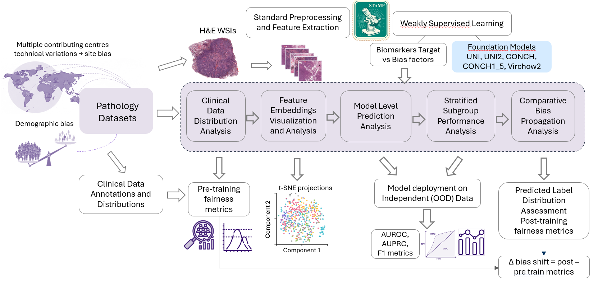

# Bias Analysis Framework for Computational Pathology

A configuration-driven framework for evaluating bias across computational pathology workflows, from clinical cohort distributions and foundation-model embeddings to trained model predictions, subgroup performance, and bias propagation.

The project uses one shared YAML configuration to organize datasets, targets, population factors, feature extractors, STAMP execution, metrics, and outputs.

## Project workflow



## Main capabilities

- Clinical distribution and pretraining bias analysis
- STAMP feature extraction
- Feature-embedding bias analysis using enabled PCA, t-SNE, and UMAP projections
- Configuration-driven STAMP cross-validation training
- Checkpoint deployment and regular prediction-performance analysis
- Stratified subgroup performance analysis
- Pretraining versus posttraining bias-propagation analysis

## Seven-step workflow

| Step | Workflow | Purpose |
|---|---|---|
| 1 | Clinical distribution analysis | Validate inputs and measure pretraining representation and disparity |
| 2 | STAMP feature extraction | Generate feature embeddings from whole-slide images |
| 3 | Feature embedding bias analysis | Evaluate target and bias-factor structure in learned embeddings |
| 4 | STAMP model training | Train cross-validation models for configured labels |
| 5 | Regular model prediction analysis | Deploy checkpoints and evaluate overall predictive performance |
| 6 | Stratified subgroup performance analysis | Compare target performance across population subgroups |
| 7 | Comparative bias propagation analysis | Determine whether predictions amplify or attenuate existing disparity |

Each workflow directory contains a step-specific `README.md` and `outputs.md`.

## Documentation

- [Project overview](docs/project_overview.md)
- [Configuration guide](docs/config_guide.md)
- [Input data requirements](docs/input_data_requirements.md)
- [Workflow guide](docs/workflow_guide.md)
- [Output structure](docs/output_structure.md)

The root README provides orientation and a quick start. Shared concepts belong in `docs/`; exact workflow settings and artifacts belong in each workflow directory.

## Repository structure

```text
bias_analysis_framework/
├── configs/
│   └── bias_analysis_config.example.yaml
├── docs/
├── src/
│   └── bias_analysis_framework/
├── workflows/
│   ├── step_1_clinical_distribution_analysis/
│   ├── step_2_stamp_feature_extraction/
│   ├── step_3_feature_embedding_bias_analysis/
│   ├── step_4_stamp_model_training/
│   ├── step_5_regular_model_prediction_analysis/
│   ├── step_6_stratified_subgroup_performance_analysis/
│   └── step_7_comparative_bias_propagation_analysis/
├── pyproject.toml
└── README.md
```

## Requirements

The package metadata declares the core Python dependencies, including:

- NumPy
- pandas
- SciPy
- scikit-learn
- matplotlib
- openpyxl
- PyYAML
- h5py
- umap-learn

STAMP is a separate workflow dependency for Steps 2, 4, and 5. Its templates, command, working directory, cache paths, and optional environment values are configured in YAML.

Python 3.9 or later is required by the current package metadata.

## Installation

Create and activate a Python environment, then install the project from the repository root:

```bash
python -m pip install -e .
```

For development tools:

```bash
python -m pip install -e ".[dev]"
```

Install and validate STAMP separately before executing STAMP-facing workflows.

## Quick start

Copy the example configuration:

```bash
# Linux/macOS
cp configs/bias_analysis_config.example.yaml configs/local_config.yaml

# Windows PowerShell
Copy-Item configs/bias_analysis_config.example.yaml configs/local_config.yaml
```

Update project, data, cohort, model, target, bias-factor, and STAMP paths.

```yaml
project:
  output_root: "/path/to/results"
  random_seed: 42

data:
  clinical_table: "/path/to/clinical_table.xlsx"
  slide_table: "/path/to/slide_table.csv"
  wsi_root: "/path/to/wsi"
  feature_root: "/path/to/features"
  patient_column: "PATIENT"
  slide_filename_column: "FILENAME"

cohort:
  organ: "CRC"
  dataset: "TCGA"
```

Bias-factor entries may separate display names from clinical columns:

```yaml
bias_factors:
  - name: "Race"
    column: "Race Category"
```

`name` is used in reports and figures. `column` is used to access the clinical table.

## Running workflows

Run commands from the repository root. For example:

```bash
python workflows/step_1_clinical_distribution_analysis/run_clinical_distribution_analysis.py \
  --config configs/local_config.yaml
```

Run workflows in numerical order unless compatible earlier artifacts are already available.

For STAMP-facing workflows, begin with:

```yaml
execute: false
```

This generates and validates configurations and commands without starting expensive processing.

## Output organization

Each workflow writes below:

```text
{project.output_root}/{workflow_name}/{organ}__{dataset}/
```

The double underscore in `{organ}__{dataset}` is intentional.

Depending on the workflow, the cohort directory may contain:

```text
configs/
logs/
tables/
figures/
predictions/
crossval_results/
```

See [Output Structure](docs/output_structure.md) and each workflow's `outputs.md` for exact artifacts and interpretation.

## Validation

Compile the Python source and workflow runners:

```bash
python -m compileall src workflows
```

Validate the example configuration:

```bash
python - <<'PY'
from pathlib import Path
import yaml

path = Path("configs/bias_analysis_config.example.yaml")
with path.open("r", encoding="utf-8") as handle:
    config = yaml.safe_load(handle)

print("Configuration loaded successfully")
print("Configured workflows:", list(config["workflows"]))
PY
```

For an initial end-to-end smoke run, use one cohort, one model, one binary target, one bias factor, one split, and `execute: false` where supported.

## Reproducibility

The framework records generated STAMP configurations, command logs, model and split identifiers, metric workbooks, output paths, and workflow status information. Set `project.random_seed` for supported stochastic operations.

## Data privacy and governance

Whole-slide images, clinical tables, embeddings, checkpoints, and predictions are not included in the repository. Users are responsible for handling patient-related data according to institutional approvals, access controls, and applicable data-governance requirements.

## Limitations

- Metric availability depends on class counts and subgroup sizes.
- AUROC and related binary metrics require appropriate class representation.
- High-cardinality bias factors may require explicit subgroup selection or minimum-count handling.
- STAMP compatibility depends on the installed STAMP version and templates.
- Observed subgroup disparity does not independently establish causality, fairness, or clinical suitability.

## Project status

The seven-step configuration-driven framework is implemented and available for research review and reuse. 
The project is under active development. Documentation, automated tests, continuous integration, packaging metadata, and workflow validation will continue to be refined. The framework is intended for research use and has not been validated for clinical decision-making. Interfaces, configuration options, and generated outputs may change in future versions.


## Repository scope

This repository provides the curated research implementation of the Bias
Analysis Framework. It includes the configuration-driven workflow code,
example configuration, project documentation, and output guides intended
for review and reuse.

The repository does not include patient data, whole-slide images, feature
embeddings, checkpoints, predictions, generated outputs, private
configuration files, or deprecated development material.

The framework is under active development. Testing, automated validation,
and workflow documentation will continue to be expanded.

## Citation

If you use this framework in research, please cite the software using the metadata in [`CITATION.cff`](CITATION.cff).

## License

This project is licensed under the MIT License. See [`LICENSE.md`](LICENSE.md).
